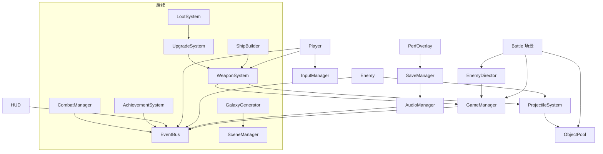

# VOID SIGNAL 技术架构

## 原则
- **数据驱动**：武器/敌人/波次在 JSON（`data/`），后续可迁移为 `Resource`（.tres）以获得编辑器支持；代码不写死数值。
- **逻辑/表现分离**：实体逻辑（移动、碰撞、伤害）不依赖渲染；`_draw()` 仅读取状态绘制。碰撞为圆形距离检测，不依赖物理引擎，便于确定性测试与 headless 运行。
- **事件总线解耦**：系统间通过 `EventBus` 信号通信（HUD、音频只订阅事件）。
- **种子随机**：每个系统持有独立 `RandomNumberGenerator`，由 run_seed 派生，保证可复现。

## 系统一览
| 系统 | 职责 | Phase 1 |
|---|---|---|
| GameManager | 运行状态、种子、计时、击杀、JSON 加载缓存、命令行参数 | ✅ autoload |
| SceneManager | 场景切换/过渡/加载 | ⏳（当前用 reload_current_scene） |
| EventBus | 全局信号 | ✅ autoload |
| InputManager | 键鼠/手柄抽象，摇杆瞄准 | ✅ autoload |
| AudioManager | SFX 合成与播放池，后续分层音乐 | ✅ 最小版 |
| SaveManager | 设置保存；版本号 + 迁移；后续自动/手动存档槽 | ✅ 设置 + v1→v2 迁移 |
| ObjectPool | 通用节点池 | ✅ autoload |
| CombatManager | 伤害结算、暴击、状态效果 | ⏳（Phase 1 合并在 Projectile/Enemy） |
| EnemyDirector | 波次、刷怪、难度曲线 | ✅ |
| WeaponSystem | 武器数据、射速、热量 | ✅ `Weapon` |
| ProjectileSystem | 池化子弹 | ✅ |
| ShipBuilder | 模块网格、连接校验、射界 | Phase 3 |
| UpgradeSystem | 升级池、稀有度、协同 | Phase 2 |
| GalaxyGenerator | 种子星图 | Phase 4 |
| LootSystem | 掉落表 | Phase 2 |
| UIManager | HUD/菜单栈 | ✅ 简化（battle 内） |
| AchievementSystem | 成就 | Phase 6 |

## 目录结构
```
void-signal/
├── project.godot            # 480x270, canvas_items, integer, 输入映射, autoload
├── autoload/                # event_bus, game_manager, input_manager, audio_manager, save_manager, object_pool
├── data/
│   ├── weapons/pulse_cannon.json
│   ├── enemies/enemies.json
│   └── waves.json
├── scenes/battle.tscn       # 主战斗场景（根节点，子树由代码构建）
├── scripts/                 # battle, player, weapon, projectile, enemy, enemy_director,
│                            # starfield, hud, perf_overlay, menu_panel, damage_number, pixel
├── assets/icon.png          # Python/PIL 生成的原创图标
└── *.md                     # 文档
（规划：scenes/{ui,ship_builder,galaxy}/, data/{modules,upgrades,bosses,environments}/, resources/）
```

## 场景结构（battle.tscn 运行时）
```
Battle (Node2D, battle.gd)
├── CanvasLayer(-10) → Starfield (视差星空)
├── World (Node2D)
│   ├── Line2D 竞技场边界
│   ├── EnemyLayer → Enemy*
│   ├── Player → Camera2D (平滑+震动)
│   ├── ProjectileLayer → Projectile*（池化）
│   └── FxLayer → CPUParticles2D 爆炸 / 伤害数字
├── EnemyDirector (Node)
└── CanvasLayer(10, PROCESS_ALWAYS)
    ├── HUD (Control)
    ├── PerfOverlay (Label, F3)
    └── MenuPanel（暂停/胜利/失败，动态创建）
```

## 系统依赖图


## 存档
`user://settings.json`，字段 `version`；`_migrate()` 逐版本升级（示例：v1 `volume`(线性) → v2 `sfx_volume_db`）。后续存档槽：`auto.json`（节点切换时自动）+ `slot_N.json`（手动）。
