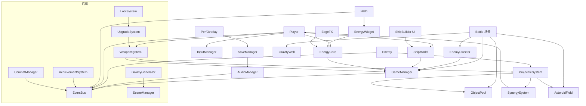

# VOID SIGNAL 技术架构

## 原则
- **不依赖全局 class_name**：所有跨脚本引用使用 `const X = preload("res://scripts/x.gd")`，避免未导入/缓存缺失（`.godot/global_script_class_cache.cfg`）时解析失败；脚本内不再声明 `class_name`。
- **数据驱动**：武器/敌人/波次在 JSON（`data/`），后续可迁移为 `Resource`（.tres）以获得编辑器支持；代码不写死数值。
- **逻辑/表现分离**：实体逻辑（移动、碰撞、伤害）不依赖渲染；`_draw()` 仅读取状态绘制。碰撞为圆形距离检测，不依赖物理引擎，便于确定性测试与 headless 运行。
- **事件总线解耦**：系统间通过 `EventBus` 信号通信（HUD、音频只订阅事件）。
- **种子随机**：每个系统持有独立 `RandomNumberGenerator`，由 run_seed 派生，保证可复现。

## 系统一览
| 系统 | 职责 | Phase 1 |
|---|---|---|
| GameManager | 运行状态、种子、计时、击杀、JSON 加载缓存、命令行参数 | ✅ autoload |
| SceneManager | 场景切换/过渡/加载 | ⏳（当前用 reload_current_scene） |
| EventBus | 全局信号 | ✅ autoload |
| InputManager | 键鼠/手柄抽象，摇杆瞄准 | ✅ autoload |
| AudioManager | SFX 合成与播放池，后续分层音乐 | ✅ 最小版 |
| SaveManager | 设置保存；版本号 + 迁移；后续自动/手动存档槽 | ✅ 设置 + v1→v2 迁移 |
| ObjectPool | 通用节点池 | ✅ autoload |
| CombatManager | 伤害结算、暴击、状态效果 | ⏳（Phase 1 合并在 Projectile/Enemy） |
| EnemyDirector | 波次、刷怪、难度曲线 | ✅ |
| WeaponSystem | 武器数据、射速、热量 | ✅ `Weapon` |
| ProjectileSystem | 池化子弹 | ✅ |
| ShipBuilder | 模块网格、连接校验、射界 | ✅ Phase 2：`ship_model.gd`（模型/校验/属性/损伤）+ `ship_builder.gd`（Tab 调试 UI） |
| EnergyCore | 三系统能量分配、预设、超载、核心热量、过热禁用 | ✅ Phase 2 `energy_core.gd` |
| SynergySystem | 数据驱动协同、玩家命中伤害路由 | ✅ Phase 2 `synergy_system.gd` |
| Localization (Loc autoload) | 解析 CSV → Translation，语言切换/保存，安装像素字体为 ThemeDB 默认字体 | ✅ Phase 2b `autoload/localization.gd` |
| Environment | 小行星带（Phase 2b 起按区块无尽生成） | ✅ Phase 2 `asteroid_field.gd` + `asteroid.gd` |
| UpgradeSystem | 升级池、稀有度 | Phase 3（协同已先行实现） |
| GalaxyGenerator | 种子星图 | Phase 4 |
| LootSystem | 掉落表 | 部分：小行星 Scrap 掉落；完整掉落表 Phase 3 |
| UIManager | HUD/菜单栈 | ✅ 简化（battle 内） |
| AchievementSystem | 成就 | Phase 6 |

## 目录结构
```
void-signal/
├── project.godot            # 480x270, canvas_items, integer, 输入映射(键鼠+手柄), autoload, features 4.7
├── autoload/                # localization(Loc), event_bus, game_manager, input_manager, audio_manager, save_manager(v3), object_pool
├── data/
│   ├── weapons/{pulse_cannon,missile_swarm,gravity_bomb,emp_launcher}.json
│   ├── enemies/enemies.json # 含 shield
│   ├── modules.json         # 模块定义：hp/mass/power/connectors/exhaust/arc/stats
│   ├── ships/default_ship.json
│   ├── energy.json          # 预设、效果曲线、超载/过热参数
│   ├── synergies.json
│   ├── environments/asteroid_field.json  # 区块参数
│   ├── i18n/strings.csv     # keys,en,zh（importer=keep）
│   └── waves.json
├── scenes/battle.tscn
├── scripts/
│   ├── battle.gd            # 场景根 + 生成 API
│   ├── player.gd  ship_model.gd  energy_core.gd  weapon.gd  projectile.gd
│   ├── enemy.gd  enemy_director.gd  gravity_well.gd  synergy_system.gd
│   ├── asteroid_field.gd  asteroid.gd  starfield.gd
│   ├── hud.gd  energy_widget.gd  edge_fx.gd  ship_builder.gd  menu_panel.gd  perf_overlay.gd  float_text.gd
│   ├── autotest_driver.gd   # headless 自动测试
│   └── pixel.gd             # 调色板 + 像素掩码绘制
├── assets/icon.png
└── assets/fonts/fusion-pixel/  # woff2 + OFL.txt + LICENSES/
```

## 场景结构（battle.tscn 运行时）
```
Battle (Node2D, battle.gd)
├── CanvasLayer(-10) → Starfield (视差星空)
├── World (Node2D)
│   ├── Line2D 竞技场边界
│   ├── WellLayer → GravityWell*
│   ├── AsteroidField → Asteroid*（+ 拾取物/陨石预警由 field 绘制）
│   ├── EnemyLayer → Enemy*
│   ├── Player → Camera2D (平滑+震动)
│   ├── ProjectileLayer → Projectile*（池化）
│   └── FxLayer → CPUParticles2D 爆炸 / FloatText
├── SynergySystem (Node)
├── EnemyDirector (Node)
├── AutotestDriver (仅 --autotest)
└── CanvasLayer(10, PROCESS_ALWAYS)
    ├── EdgeFX (过热边缘失真)
    ├── HUD (Control) → EnergyWidget (三角)
    ├── PerfOverlay (Label, F3)
    ├── ShipBuilder (Tab, PROCESS_ALWAYS)
    └── MenuPanel（暂停/胜利/失败，动态创建）
```

## 系统依赖图


## 存档
`user://settings.json`，字段 `version`；`_migrate()` 逐版本升级（示例：v1 `volume`(线性) → v2 `sfx_volume_db`）。后续存档槽：`auto.json`（节点切换时自动）+ `slot_N.json`（手动）。

## Phase 2 关键数据流
- 能量：`EnergyCore.mult(effect)` = 曲线 `[base, slope]` 以 BALANCED=1.0 归一；超载时份额 ×1.4。Player 每帧读取（伤害/射速/散热/护盾/加速/极速/转向/冲刺）。
- 舰船：`ShipModel.revalidate()` BFS 从核心出发，仅双方在相邻边都有 connector 才连通 → `connected`；属性只累加连通模块；主推尾焰（exhaust 边）被遮挡不提供推力。受击 `damage_from(局部方向)` 选外侧模块，核心/驾驶舱 hull≥30% 时受保护；模块被毁后重新校验，存在冗余连接的模块保持在线。
- 射界：挂点朝向 = (挂点-核心) 方向与正前方的中间角；`arc` 来自数据；瞄准方向不在射界内的挂点不开火。
- 协同：玩家子弹命中统一走 `SynergySystem.on_player_hit()`；EMP 爆炸走 `on_emp_blast()`；导弹索敌走 `missile_target()`。

## Phase 2b：本地化与竖屏无尽战场
- **本地化**：`Loc` 在启动时用 `FileAccess.get_csv_line()` 读 `strings.csv`，为 en/zh 各建一个 `Translation` 并 `TranslationServer.add_translation()`；不依赖 Godot 的 CSV 导入，因此删除 `.godot` 后直接运行也可用。代码中一律 `tr("KEY")`；静态/RefCounted 上下文可用 `TranslationServer.translate()`。ShipModel 错误以 `ERR_*` 键存储，由 `error_text()` 本地化并格式化。动态键：`MOD_*`、`ABBR_*`、`WPN_*`、`WPNA_*`、`SYN_*`、`PRESET_*`。
- **字体**：`FontFile.data = 文件字节`，antialiasing=NONE、hinting=NONE、subpixel=DISABLED，设为 `ThemeDB.fallback_font`（大小 12），所有 Label/Button/draw_string 共用。
- **滚动模型**：`battle.scroll_y` 每帧减少 `base_scroll_speed*delta`，玩家同步上移（玩家速度为“屏幕系”）；玩家越过推进线（scroll_y-100）时镜头追上 → 前推加速。`distance() = -scroll_y`。`constrain_player()` 提供水平带（±118）与竖直窗口的软墙。
- **区块**：区块 k 覆盖 y∈[-(k+1)·480, -k·480]，RNG 种子 `hash([run_seed+101, k])`，同种子同地形；保持前方 2 个区块，区块顶边低于视口下沿 260px 时整体释放；漂离的碎片/陨石/拾取物同样按下沿剔除。敌人落到视口下方 120px 外被回收（不计击杀）。
