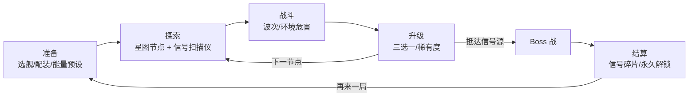

# VOID SIGNAL 游戏设计文档

## 1. 世界观与叙事
公元 **3287 年**，人类边境监听站捕获到一段来自银河外缘的**神秘信号**。信号并非讯息，而是一段"指令"：一个古老的**机械文明**正在用它**重新编码宇宙**——恒星被改写为计算单元，星区被格式化成整齐的几何结构。玩家驾驶一艘可改装的侦察舰，沿信号溯源深入"虚空"。

**环境叙事**而非过场：被格式化成方格的小行星、残骸舰上闪烁的人类遗言日志、Boss 身上逐渐显现的人类舰船零件、越接近信号源背景星空越"像素化"。每局结尾解锁一段信号解码碎片（Signal Fragment），拼出真相。

## 2. 核心循环

## 3. 动态能量核心（Dynamic Energy Core）
- 总能量 100%，分配到 **WEAPON / SHIELD / ENGINE** 三角形 UI：拖动三角内的点，三个顶点权重即三个系统的能量占比（重心坐标）。
  - WEAPON：射速、伤害倍率、热量散发；SHIELD：护盾上限与回复；ENGINE：最高速度、冲刺冷却。
- 快捷预设（数字键 1-4 / 手柄十字键）：**ASSAULT**（70/15/15）、**DEFENSE**（15/70/15）、**ESCAPE**（15/15/70）、**BALANCED**（33/33/34）。切换有 0.3s 过渡。
- **超载（Overload）**：按住超载键，总能量临时 130%，但核心热量快速上升；热量满→核心过热 3s，所有系统降至 50%。热量是所有武器共享的"第二资源"，形成"爆发—冷却"节奏。

## 4. 模块化舰船构建
- 网格（如 7×7）上放置模块：核心、武器、护盾发生器、引擎、装甲、散热器、能量导管。
- **连接有效性**：所有模块必须经导管/相邻关系连通至核心，不连通的模块显示红色且不生效；引擎必须朝后无遮挡。
- **射界（Firing Arc）**：每个武器挂点有扇形射界（编辑器中可视化），被其他模块遮挡的角度被剔除。
- **模块损伤与容错**：模块拥有独立 HP；被毁后断开其下游模块，但冗余导管提供备用路径（容错），鼓励"环形"布局；核心被毁即死亡。

## 5. 六种环境（全部有预警 Telegraph）
| 环境 | 机制 | 预警 |
|---|---|---|
| 小行星带 | 漂移陨石，可被击碎提供掩体/碎片伤害 | 大型陨石进入前屏幕边缘箭头 |
| 黑洞边缘 | 持续引力拉扯，越近越强；子弹轨迹弯曲 | 引力透镜扭曲 + 地面波纹圈 |
| 离子风暴 | 周期性 EMP 区域禁用护盾/HUD 干扰 | 闪电区域先闪 1.5s 虚线框 |
| 舰船坟场 | 残骸遮挡视线，可拾取残骸模块；休眠炮台 | 炮台激活前红色扫描线 |
| 不稳定恒星耀斑 | 定时扇形高伤耀斑扫过 | 2s 前扇形渐亮 + 音频上升音 |
| 虚空异常 | 空间折叠：传送门、局部时间减缓、反转操控 | 紫色像素噪点区域预先出现 |

## 6. 武器（10 种）
统一参数：Damage / FireRate / ProjectileSpeed / EnergyCost / HeatGeneration / CriticalChance / Range / ProjectileLifetime / SpecialEffect

| 武器 | Dmg | Rate/s | Speed | Energy | Heat | Crit | Range | Life(s) | 特效 |
|---|---|---|---|---|---|---|---|---|---|
| Pulse Cannon | 10 | 7 | 420 | 2 | 6 | 10% | 300 | 0.75 | 无（基础） |
| Plasma Beam | 4/tick | 20 | 即时 | 6/s | 18/s | 5% | 180 | — | 持续光束，伤害随照射时间递增 |
| Railgun | 80 | 0.8 | 1200 | 15 | 30 | 25% | 500 | 0.5 | 蓄力穿透全部敌人 |
| Missile Swarm | 14×6 | 1 | 220 | 10 | 20 | 10% | 350 | 2.0 | 追踪，小范围爆炸 |
| Arc Lightning | 12 | 3 | 即时 | 6 | 12 | 5% | 140 | — | 链式跳跃 4 个目标 |
| Gravity Bomb | 40 | 0.5 | 120 | 18 | 25 | 0% | 260 | 3.0 | 爆炸前吸附敌人与子弹 |
| Drone Carrier | 6 | 4/机 | 300 | 12 | 10 | 10% | 220 | 1.0 | 释放 3 架自动无人机 |
| Laser Blade | 30 | 2.5 | — | 4 | 14 | 20% | 40 | — | 近战弧斩，可反弹子弹 |
| EMP Launcher | 8 | 1 | 260 | 8 | 15 | 0% | 240 | 1.2 | 瘫痪敌人/护盾 2s |
| Void Cannon | 120 | 0.3 | 160 | 25 | 45 | 15% | 400 | 3.0 | 黑洞弹，吞噬路径上的子弹 |

## 7. 协同（20 种 Synergy 设计）
1. **导电等离子**：Plasma Beam + Arc Lightning → 光束命中处产生闪电链
2. **引力井炮台**：Gravity Bomb + Railgun → 引力聚怪后电磁炮穿透伤害×2
3. **蜂巢导弹**：Drone Carrier + Missile Swarm → 无人机携带微型导弹
4. **电磁收割**：EMP + Laser Blade → 对瘫痪敌人近战必暴击
5. **事件视界**：Void Cannon + Gravity Bomb → 黑洞弹体积+50%并持续更久
6. **过载循环**：任意 3 个高热武器 → 过热时释放冷却冲击波
7. **脉冲回响**：Pulse Cannon + BULLET ECHO → 每第 5 发分裂为 3 发
8. **静电护盾**：Arc Lightning + 护盾满 → 受击自动反击闪电
9. **冲刺刀锋**：Laser Blade + 冲刺 → 冲刺路径造成刀锋伤害
10. **轨道炮阵**：Railgun + Drone Carrier → 无人机发射小型轨道弹
11. **离子吸收**：EMP + 离子风暴环境 → 免疫风暴并充能超载
12. **碎片风暴**：Missile Swarm + 小行星带 → 击碎陨石生成追踪碎片
13. **等离子蒸发**：Plasma Beam + Void Cannon → 光束穿过黑洞弹后变为扇形
14. **重力冲刺**：GRAVITY MASTER + 冲刺 → 冲刺终点产生小型引力井
15. **最后脉冲**：LAST SIGNAL + EMP → 濒死时释放全屏 EMP
16. **双核齐射**：DOUBLE CORE + 任意两把武器 → 交替开火射速 +30%
17. **耀斑共振**：恒星耀斑 + 护盾 → 耀斑擦边为护盾充能
18. **幽灵舰队**：Drone Carrier + 舰船坟场 → 残骸被改造为临时无人机
19. **链式引爆**：Arc Lightning + Missile Swarm → 闪电触发未爆导弹
20. **虚空回声**：Void Cannon + BULLET ECHO → 黑洞弹消失处生成小黑洞

## 8. 升级稀有度
- **COMMON**（白）：数值 +10~15%；**RARE**（青 #49E6D4）：新机制小改动；**EPIC**（紫 #A78BFA）：武器形态变化；**LEGENDARY**（金 #FFCC66）：改变构筑方向；**ANOMALY**（红 #FF5268，带负面代价）。
- 构筑改变型示例：
  - **DOUBLE CORE**：第二能量核心，可同时启用两个预设，但热量共享
  - **BULLET ECHO**：所有子弹 0.3s 后在原位置重放一次（50% 伤害）
  - **LAST SIGNAL**：每局一次，致命伤害时进入 5s 无敌狂暴并回复 30% 船体
  - **GRAVITY MASTER**：所有弹体受玩家附近引力影响环绕，可"甩出"
  - **DRONE HIVE**：每击杀生成临时无人机（上限 8）
  - **OVERLOAD ENGINE**（ANOMALY）：永久超载 120%，但护盾上限 -50%

## 9. 敌人与模块化 AI
AI = **移动模块**（Chase/Orbit/Keep-Distance/Flank/Swarm-Boids）+ **攻击模块**（Contact/Aimed/Burst/Spread/Beam）+ **辅助模块**（Heal/Shield/Buff），数据配置组合。
- SCOUT：追击撞击（Phase 1 已实现）
- INTERCEPTOR：环绕扫射（已实现）
- BOMBER：保持距离扇形散射（已实现）
- SNIPER：远距离蓄力激光，有瞄准线预警
- SUPPORT：为友军加盾/修复
- SWARM：群体 Boids 小型机
- ELITE：任意类型+词缀（护盾、分裂、反射）

## 10. Boss（5 个概念）
1. **THE WATCHER（守望者）**：巨大机械眼。可破坏部件：2 个侧翼炮台、眼睑装甲、核心透镜。
   - P1：扫描光束（地面预警线）+ 炮台弹幕；破坏炮台降低弹幕密度
   - P2（70%）：眼睑打开，召唤 SCOUT 群，核心透镜可被攻击
   - P3（30%）：信号过载，屏幕逐渐像素化，全屏旋转光束 + 安全扇区
2. **THE ARCHIVIST（档案员）**：吞噬残骸重建自身，复制玩家武器
3. **ORBITAL CHOIR（轨道合唱团）**：多个同步卫星，需按顺序击破
4. **THE FORMATTER（格式化者）**：把战场切成网格并逐格"删除"
5. **ECHO OF 3287（3287 的回声）**：信号源，镜像玩家构筑的最终 Boss

## 11. 星图与信号扫描仪
- 分层节点星图（每星区 ~12 节点，种子生成）：战斗、精英、商店、残骸（事件）、异常、休整、Boss。
- **SIGNAL SCANNER**：消耗扫描能量揭示相邻节点类型、环境与奖励稀有度；信号强度提示隐藏节点。

## 12. 进程（两层，无 Pay-to-Win）
- 局内：升级、模块、能量、货币（Scrap）。
- 局外：信号碎片解锁**横向内容**（新武器、新模块、新舰体、新预设、Lore），不提供纯数值加成。无内购、无付费数值。

## 13. 视觉与 UI
- 调色板：`#080C18` 背景 / `#10182B` 面板 / `#49E6D4` 主色青 / `#FF5268` 危险红 / `#FFCC66` 警示金 / `#A78BFA` 异常紫 / `#EAF4FF` 文字白
- 480×270 内部分辨率，canvas_items 拉伸 + 整数缩放，最近邻过滤，像素吸附。

## 14. 音频
分层音乐：基础层（氛围 pad）+ 战斗层（鼓）+ 危险层（低频，Boss/低血）按强度淡入淡出；SFX 程序合成为主。Phase 1 仅程序合成 SFX。

## 15. 调试
F3 性能面板（FPS、帧时间、敌人、子弹、Draw Calls、内存、节点）；Debug 模式（后续）：无敌、刷怪、跳波、显示碰撞半径；`--autotest` 命令行自动驾驶回归测试。

## 16. 六阶段路线图
1. **Phase 1 核心战斗原型**（本阶段）
2. Phase 2 武器系统 10 种 + 热量/能量核心三角 UI + 升级三选一
3. Phase 3 模块化舰船编辑器 + 模块损伤
4. Phase 4 星图/信号扫描仪/6 环境/敌人全家族
5. Phase 5 Boss（THE WATCHER 起）+ 协同 + 局外进程 + 存档
6. Phase 6 叙事、音频分层、打磨、性能、Web/桌面发布

## 17. Phase 2 已实现规格（数值见 data/*.json）
- **能量**：份额最小 5%；预设 ASSAULT 60/20/20、DEFENSE 20/60/20、ESCAPE 20/20/60、BALANCED 33/33/33；过渡速度 4/s。示例（实测 autotest）：ASSAULT 伤害×1.45 射速×1.53，DEFENSE 护盾回复×1.70，ESCAPE 加速×1.53 极速×1.40。
- **超载**：按住 Shift，总能量 140%，核心热量 +34/s（冷却 22/s + 散热器加成）；≥65 警告 + 屏幕边缘像素失真；100 过热 → 随机禁用 武器挂点/护盾发生器/侧推 4 秒，热量回到 55，冷却到 30 前锁定超载。
- **模块**：驾驶舱、核心（供能 24）、主推（尾焰需空）、侧推（转向）、武器挂点（射界 150°）、护盾发生器、装甲、散热器。规则：唯一核心 + 驾驶舱 + 至少一个有效主推 + 能量不为负 + 全部连通。
- **敌人护盾**：interceptor 15、bomber 45，EMP 直接清空并眩晕 1.6s、标记 3.5s。
- **协同**：GRAVITY LOCK（导弹优先追踪井中敌人，伤害×1.6）；OVERCHARGE BREACH（EMP 标记敌人被脉冲/导弹命中必暴击×2.5）；ION VORTEX（EMP 覆盖引力井 → 井变离子漩涡 +28 DPS、持续眩晕、延长 1.5s）。
- **小行星带**：26 块种子生成，25% 爆炸矿石（半血点燃，1.2s 引信并显示爆炸半径红圈，连锁引信减半），大石头碎裂为 2 块，Scrap 磁吸拾取；每 14s 一颗陨石，提前 2s 显示红色虚线轨迹与 “!” 标记。

## 18. “是否更好玩”试玩评估清单（请用户实机填写）
| # | 问题 | 1-5 分 | 备注 |
|---|---|---|---|
| 1 | 切换能量预设时能否**立即感受到**差异（射速/速度/护盾）？ | | |
| 2 | 战斗中是否会**主动**切换预设，而不是一直用 BALANCED？ | | |
| 3 | 超载的“风险-收益”是否清晰？过热前是否有足够预警？ | | |
| 4 | 过热禁用模块是否有趣，还是只觉得惩罚？ | | |
| 5 | 编辑器里改装后，飞行手感/火力差异是否明显？ | | |
| 6 | 模块被打掉时是否看得懂发生了什么（文字、HUD 小地图）？ | | |
| 7 | 引力井 + 导弹 / EMP + 引力井 组合是否让人想去刻意打出？ | | |
| 8 | 协同提示文字是否足够显眼又不打扰？ | | |
| 9 | 小行星作为掩体/障碍是否改变了走位？连锁爆炸是否爽？ | | |
| 10 | 陨石预警是否公平（来得及躲）？ | | |
| 11 | 屏幕边缘失真是否不适？REDUCE FLASH 是否足够？ | | |
| 12 | 一局 3 分钟是否太长/太短？难度曲线如何？ | | |
